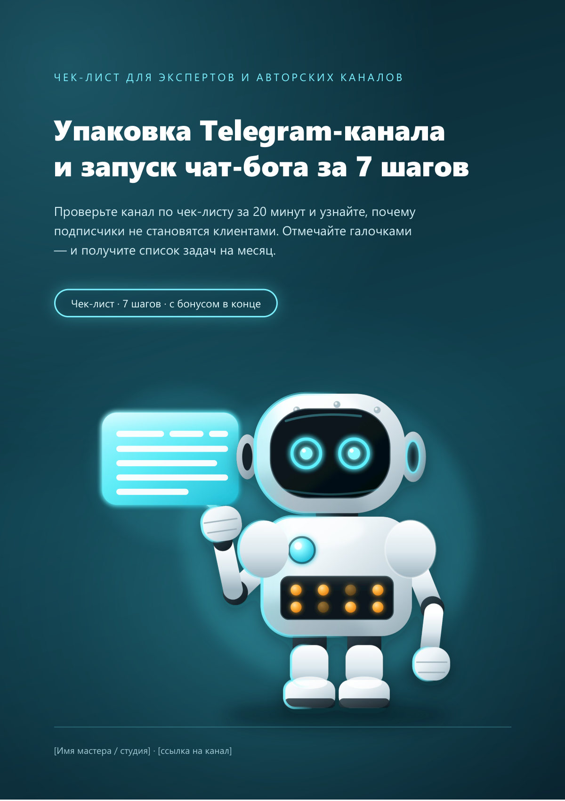

<div align="center">

# Telegram-канал и чат-бот за 7 шагов

**Чек-лист · 8 страниц · бесплатно**

[](https://Mary-RND.github.io/lead-magnet-telegram-bot/)
[](https://Mary-RND.github.io/lead-magnet-telegram-bot/download/telegram-kanal-i-bot.pdf)
[](https://Mary-RND.github.io/lead-magnet-telegram-bot/)

[Открыть страницу →](https://Mary-RND.github.io/lead-magnet-telegram-bot/) · [Скачать PDF](https://Mary-RND.github.io/lead-magnet-telegram-bot/download/telegram-kanal-i-bot.pdf) · [Заказать такой же](https://t.me/marypetrova6)

</div>



## О лид-магните

Проверьте канал за 20 минут: шапка и закреп, рубрики, лид-магнит, сценарий бота из 5 цепочек, монетизация и сводный чек-лист упаковки.

Страница на GitHub Pages показывает **все 8 страниц** лид-магнита
скриншотами — можно пролистать перед скачиванием.

## Что в репозитории

```
index.html          — страница со всеми страницами PDF
screenshots/        — 8 превью в полном размере
download/telegram-kanal-i-bot.pdf
README.md
.nojekyll           — отключает Jekyll на GitHub Pages
```

## Заказать такой же

- **Стоимость:** 3 000 ₽ · **Срок:** 1 ч 10 мин
- Telegram: [@marypetrova6](https://t.me/marypetrova6)
- E-mail: [mar.petrushina@yandex.ru](mailto:mar.petrushina@yandex.ru)
- Портфолио: [mary-rnd.github.io/portfolio](https://mary-rnd.github.io/portfolio/)

---

© 2026 Марина Петрушина. Материалы можно использовать в личных целях;
перепродажа и публикация без согласия автора запрещены.
